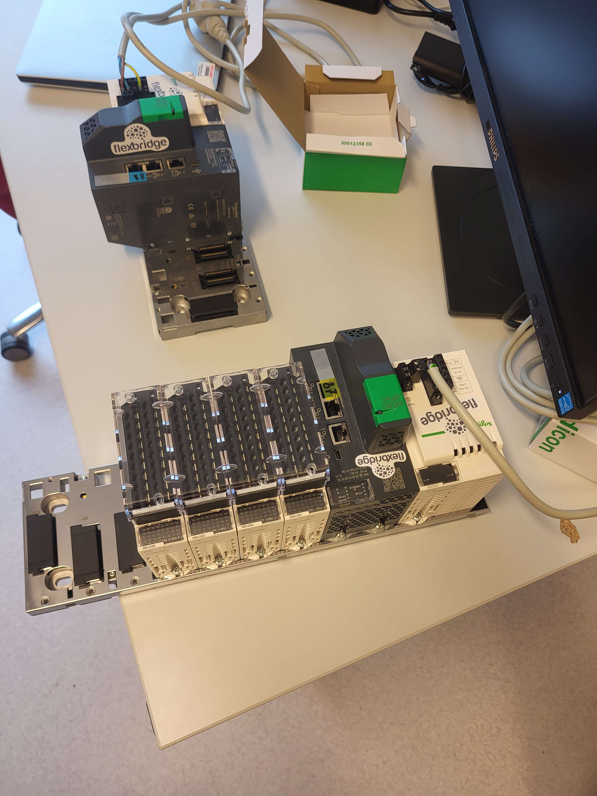
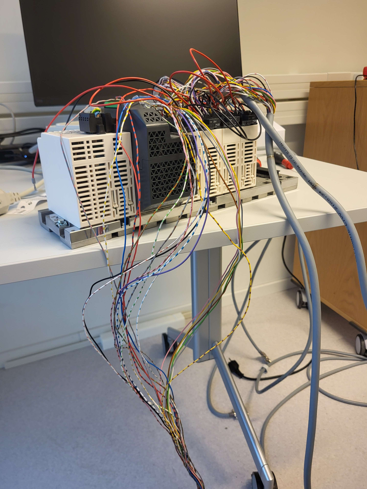

# Rewire

Since the the firmware, hardware and software in the lab is all over 10 years old there are a lot of support issues when new features are needed. Thus since the old hardware does not have support of EAE firmware all the hardware it the lab needs to be rewired to new controllers that supports it.

The first step in this process was to disconnect all NXTStudio hardware that was currently plugged in to the relevant stations (1, 6 and conveyor belt) and remove all wires from them. We started with building a controller consiting of a CPS200 power supply, modicon mp580 process module, two input ports and two output ports. This resulted as seen below.

The reasoning for the hardware was since that was the available hardware already existing in EISLAB. 

For this module to actually be able to connect to the stations, wired connections where needed. For the connections we reused the old wires that was previously connected to the NXTStudio modules, however since a lot of those cable had gone bad we needed to trim them a bit and add new "hats" to the copper edges. Since every wire is corresponds to a specific I/O port in the module we followed Scheider electronics wiring guide to connect them to their specific ports. Since I do not want to go into detail the exact color code scheme that the follow for every port we will skip it, but however a good detail to take away is that fully colored in cables are linked to output ports and cables with two colors are connected to input ports. The system when fully built lokked something like this: 

To test that this setup actually was correctly connected we connected its power supply to a 24V outage in the lab and mp580 to station 6. From here we used a multimeter to check every port individually that get had power since if a single port did not receive power, the entire module is incorrectly connected. First try... It did not work. 

Second try however we had power! and we called it a day. 