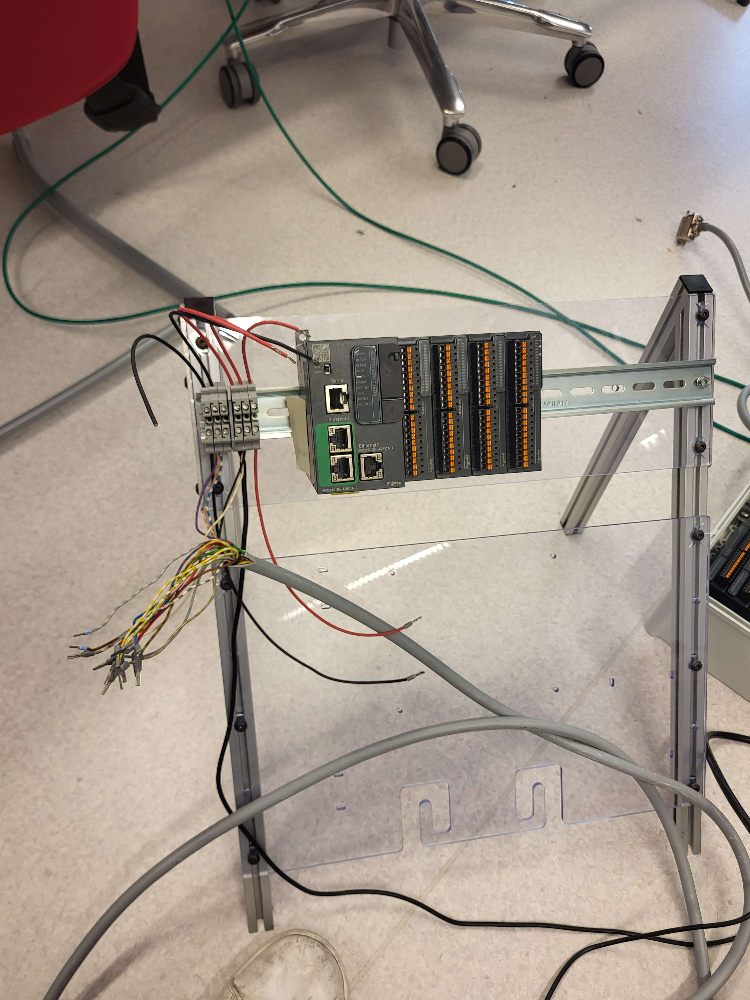
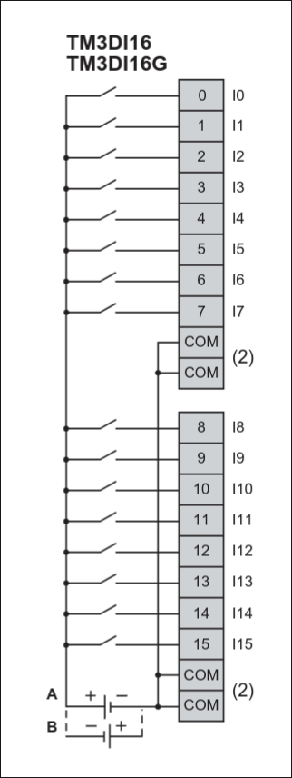
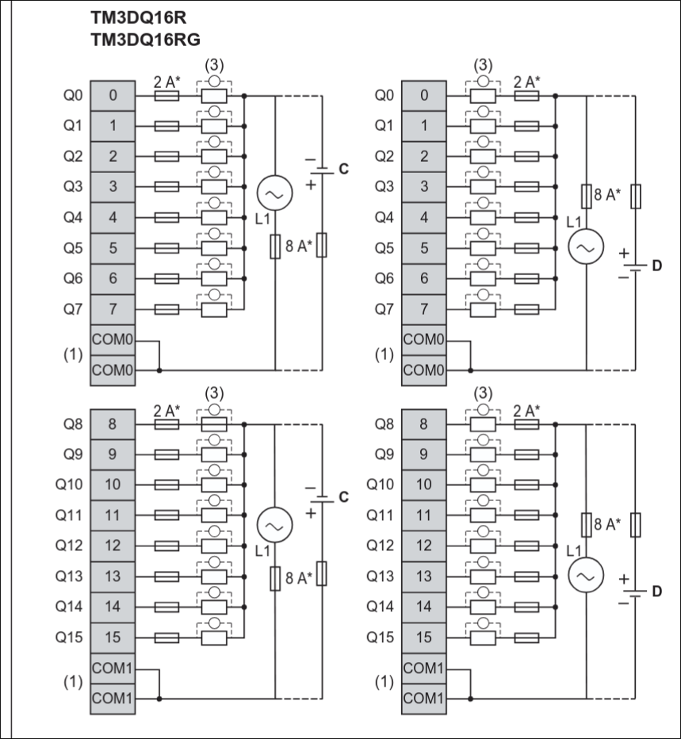
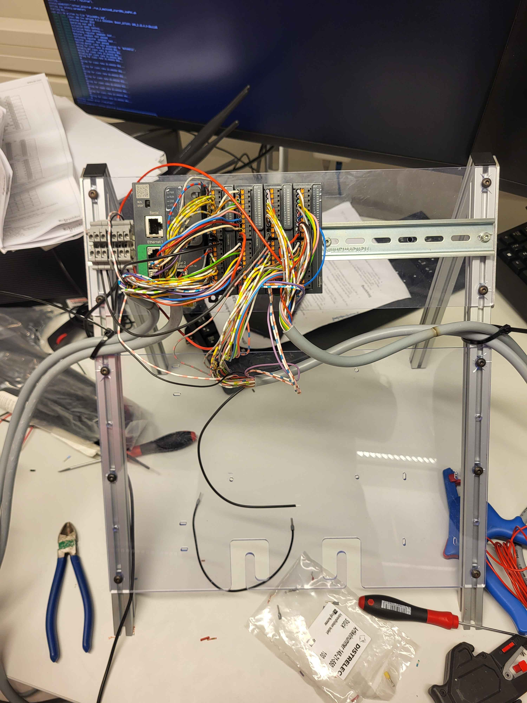
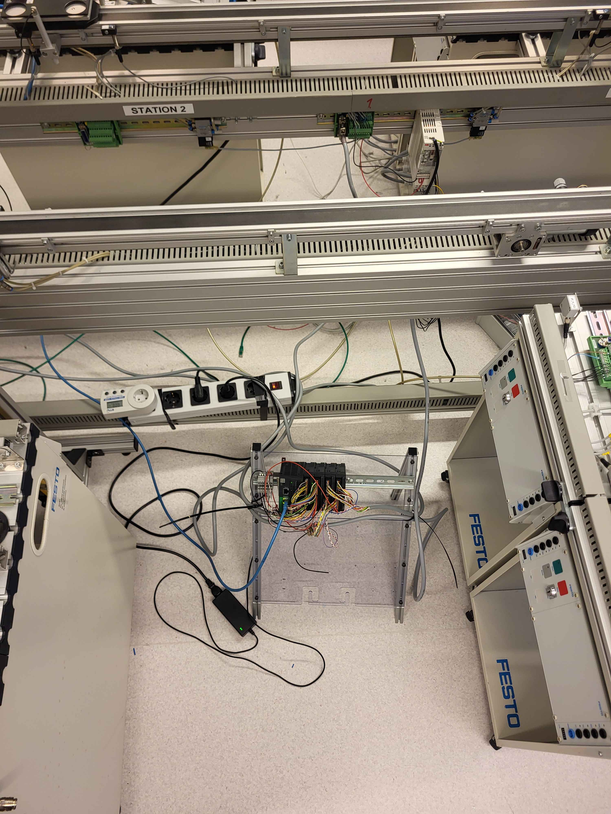

# Rewire

This document will be a mix of a journal of the steps taken with documentation to make it easier for the reader to understand steps taken by us, issues we faced and how they were solved.

Since the the firmware, hardware and software in the lab is all over 10 years old there are a lot of support issues when new features are needed. Thus since the old hardware does not have support of EAE firmware all the hardware it the lab needs to be rewired to new controllers that supports it.

The first step in this process was to disconnect all NXTStudio hardware that was currently plugged in to the relevant stations (1, 6 and conveyor belt) and remove all wires from them. We started with building a controller consiting of a CPS200 power supply, modicon mp580 process module, two input ports and two output ports. This resulted as seen below.

The reasoning for the hardware was since that was the available hardware already existing in EISLAB.

For this module to actually be able to connect to the stations, wired connections where needed. For the connections we reused the old wires that was previously connected to the NXTStudio modules, however since a lot of those cable had gone bad we needed to trim them a bit and add new "hats" to the copper edges. Since every wire is corresponds to a specific I/O port in the module we followed Scheider electronics wiring guide to connect them to their specific ports. Since I do not want to go into detail the exact color code scheme that the follow for every port we will skip it, but however a good detail to take away is that fully colored in cables are linked to output ports and cables with two colors are connected to input ports. The system when fully built lokked something like this:

To test that this setup actually was correctly connected we connected its power supply to a 24V outage in the lab and mp580 to MPS Sorting process of station 6. From here we used a multimeter to check every port individually that get had power since if a single port did not receive power, the entire module is incorrectly connected. First try... It did not work.

Second try however we had power! and we called it a day.

So ofcourse when we came back in the morning ready to start the conveyor belt and checking the firmware nothing worked. When looking into this in more detail it revieled to be a bug in the Schneider electronics ecosystem. The double check that we were not just crazy we first talked to Sandeep that trippled checked our solution and after that contacted his contact in Schneiders customer service in order to figure this out. Currently Scheider is looking into this issue and they will come back to us when they have a solution.

In the meantime we started to build a "temporary" mobile controller that replaces the controller that we already built since there is not telling when the Schneider controller will have support for EAE.

Since we already had built one "working" controller we thought that the experience would accelerate the proccess but it seemed that this was not the case. First the wires we needed was not in the same condition as the ones that we used for the first controller so a lot of them needed to be trimmed since the exposed copper either was twisted, in knots or just broken. Then the wiring protocols for these was also a bit confusing at first to get into: 

. 

Then, since we needed three controller anyway we thought that it would be better to build all three at the same time since they would all be wired in the same way so it would be easier. The reasoning why is due to heabbian theory (neurons that wire together, fire together) or in this case if one work all work, but if one don't work nothing works. But atleast if none work, atleast we know that all of them have the exact same issue. The result came in looking like this: 

And after we plugged it in to the conveyor belt, router and the power outage: 

