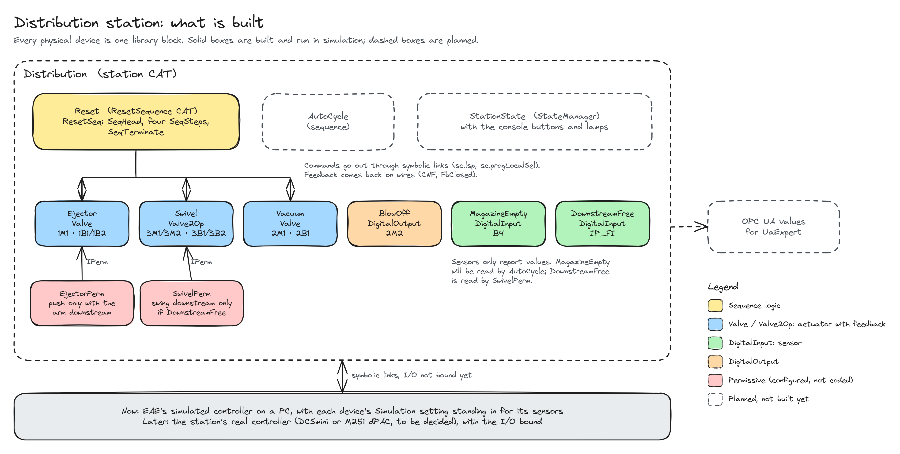
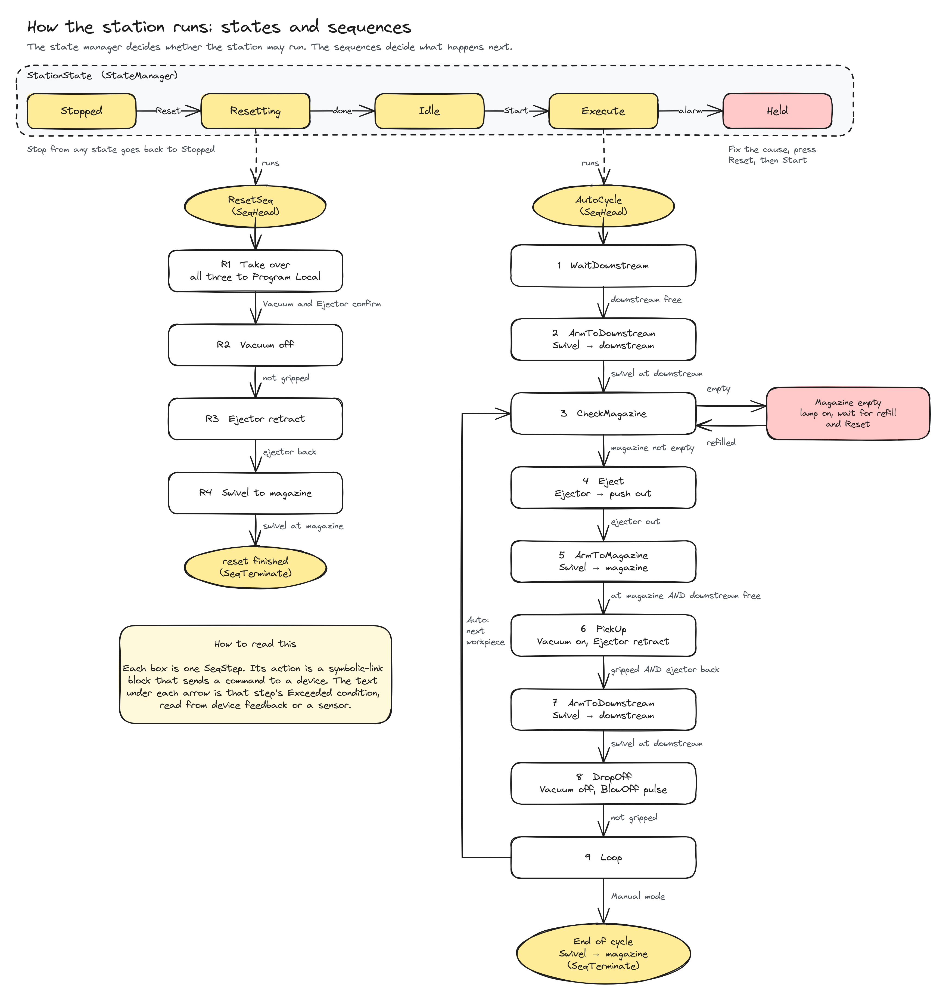

# Festo MPS - Distribution Station in EAE: Project Report

## Summary

This project rebuilds the control program of the Festo MPS Distribution station in EcoStruxure Automation Expert (EAE) 25, Schneider Electric's IEC 61499 engineering tool. Instead of porting the hand-made function blocks of the existing program, the station is assembled from Schneider Electric's library blocks, which already include faceplates, alarms, owner selection and OPC UA values.

So far the station's six device blocks, two permissives (interlocks) and a reset sequence are built and tested on EAE's simulated controller, and all seven tests pass. The automatic cycle, which takes workpieces from the magazine to the next station, is the part still to be built for the demonstration. Binding the program to the station's real I/O waits on the choice of controller.

Before this rebuild, the project studied the MPS and the EAE program left by an earlier student (a port of the the professor's code), and tried to simulate the station to produce synthetic data for the other subgroups. The simulation grew too complicated and was dropped in favour of data from a smaller system, as described under Project history.

## Project history

**Understanding the system.** The project began with learning the system: the Festo MPS stations in the lab, IEC 61499 and EAE, and the EAE program that earlier students had written and that was handed over at the start of the project. That program implements several of the stations with hand-made function blocks (for Distribution, `GiveWorkpiece`, `ArmReset` and `ControlPanel` inside the CAT `Distribution2CAT`), and it was not complete.

**A simulation block for synthetic data.** The other subgroups depended on data from the testbed. So that they would not be blocked if deployment in the lab ran into problems, we first tried to simulate the Distribution station and produce synthetic data from it. The simulator is a basic function block, `DistributionSim`, that every 50 ms turns the actuator commands into the sensor signals the station would return: the ejector reaches its end position after about 300 ms, the swivel arm after about 600 ms, and the vacuum grips after about 200 ms. It keeps the magazine full, starts the next workpiece about 1.5 s after a cycle ends, and passes the real sensors through when simulation is switched off. Its values were published over OPC UA, where a test script read them.

**Why it was dropped.** The block had to sit between the station's inputs and every block that reads them, so 37 of the 83 connections in `Distribution2CAT` now lead to or from the simulator or its clock. Each fault we fixed exposed a new one, and since Distribution is only one of several stations, we judged that further debugging was not a good use of the remaining time.

**Data from a smaller system.** We raised the problem with the supervisors and were given access to a smaller EAE application, Lifting Luggage, which has its own plant model simulation. We wrote a script that reads its sensors and actuators from its three OPC UA servers and logs every change to CSV, JSON Lines and SQLite, and a second script that appends generated cycles with physically consistent timing. With this data the LLM-KG subgroup built an ontology and connected it to the time-series database.

**Change of direction.** In the last weeks of the study period, the subgroup decided to investigate whether the Distribution program could be rewritten using only Schneider Electric's standard libraries, following guidelines discussed in a meeting with Sandeep. The rest of this report describes that work.

## Background

The Festo MPS (Modular Production System) is a line of teaching stations. Distribution is the first one: it takes workpieces from a stack magazine and passes them, one at a time, to the next station, Testing. Its hardware is:

- an ejector cylinder that pushes the bottom workpiece out of the magazine (valve coil 1M1, end-position sensors 1B1 and 1B2);
- a swivel arm that moves between the magazine and Testing, driven by two valve coils (3M1 towards the magazine, 3M2 towards Testing) with end-position sensors 3B1 and 3B2;
- a vacuum suction cup on the arm (coil 2M1, vacuum switch 2B1) and a blow-off valve that releases the workpiece (2M2);
- a magazine-empty sensor (B4) and an optical coupler, IP\_FI, that tells whether Testing is free;
- a console with Start, Stop, Reset and Auto/Man inputs and lamps.

Festo's GRAFCET for the station (`01_Distributing_GRAFCET.pdf`) defines its behaviour. The existing program is the supervisor's nxtStudio project, which runs Distribution on an nxtControl DCSmini controller. It is built from hand-made function blocks such as `GiveWorkpiece`, `ArmReset` and `ControlPanel`, and it hands workpieces to Testing through an adapter between the two station programs. An EAE version of that project written by a student also exists.

## Approach

The program follows three rules:

- Use Schneider Electric's library blocks unchanged (SE.App2CommonProcess, SE.App2Base and SE.AppSequence 25.0.1.5, and Runtime.Base 25.0.1.2), and set them through their parameters.
- Build the station's behaviour by wiring library blocks together.
- Write custom logic only where no library block fits.

Each library device block already brings its I/O links, owner selection (whether the operator or a program commands it), feedback monitoring with alarms, a faceplate for the HMI, and OPC UA values. With hand-made blocks, each of these has to be written and tested separately. The cost is learning the libraries' conventions and working around their gaps, one of which is described under Problems and solutions.

The whole station is one Composite Automation Type (CAT), `Distribution`, which holds one block per physical device plus the sequence blocks.

The design was checked against the AHU (air handling unit) example from the workshop modules, a complete EAE application built on the same libraries. It uses the same device blocks, condition blocks, owner switching and start-up chain. The difference is how commands reach the devices: the AHU drives them from hand-written function blocks wired to each device's sequence-control adapter, while this project's sequences write the devices' symbolic links, the route the library documentation gives for sequences.

## Design

*Figure 1. The station's blocks. Solid boxes are built and run in simulation; dashed boxes are planned.*

Inside the `Distribution` CAT, each physical device is one library block: three valve blocks for the Ejector, the Swivel and the Vacuum, a digital output for BlowOff, and two digital inputs for the magazine-empty sensor and the IP\_FI signal. Two permissive blocks are connected to the Ejector and the Swivel. The sequences send commands to the devices through symbolic links, and the devices' feedback comes back on wires.

*Figure 2. How the station runs. Only the reset sequence (left) is built so far.*

Control is split into three layers (Figure 2). A state manager decides whether the station may run (Stopped, Resetting, Idle, Execute, Held). Two sequences decide what happens next: the reset sequence brings the station to its home position, and the automatic cycle moves workpieces from the magazine to Testing, following Festo's GRAFCET step by step. The device blocks decide how each move is made and check that it finished. The state manager and the automatic cycle are still to be built.

## Implementation

### Devices

| Device | Library block | Coils and sensors | Why this block |
| --- | --- | --- | --- |
| Ejector | `Valve` | 1M1; 1B1, 1B2 | One coil with spring return |
| Swivel | `Valve2Op` | 3M1, 3M2; 3B1, 3B2 | One coil per direction: Open moves towards Testing, Close towards the magazine |
| Vacuum | `Valve` | 2M1; 2B1 | One coil |
| BlowOff | `DigitalOutput` | 2M2 | A plain output with no feedback |
| MagazineEmpty | `DigitalInput` | B4 | A sensor |
| DownstreamFree | `DigitalInput` | IP\_FI | A sensor |

Each valve block watches its own feedback and raises an alarm when a move does not complete. In simulation, each block's Simulation setting stands in for its sensors.

### Permissives

Two `permCondItem` blocks refuse moves that would collide:

- `EjectorPerm`: the Ejector only pushes when the arm is downstream, so the pushed workpiece does not hit the arm.
- `SwivelPerm`: the arm only swings downstream when DownstreamFree reports that Testing is free.

A permissive only refuses a new command; it never stops a move that is already running. When it refuses, the device's symbol shows a ⊘ icon and its faceplate lists the failing condition.

### Reset sequence

The reset sequence, `ResetSeq`, is built from SE.AppSequence blocks in its own CAT, `ResetSequence`: a `SeqHead`, four `SeqStep` blocks and a `SeqTerminate`. It has to be a CAT because the sequence blocks are CATs themselves, which can only be placed inside another CAT.

| Step | Command | Done when |
| --- | --- | --- |
| R1 Take over | Switch the Vacuum, the Ejector and the Swivel to the owner Program Local | The Vacuum and the Ejector report Program Local |
| R2 Vacuum off | Vacuum to Close | The Vacuum reports closed |
| R3 Ejector retract | Ejector to Close | The Ejector reports closed |
| R4 Swivel to magazine | Swivel to Close | The Swivel reports closed |

Each command is a `SYMLINKMULTIVARSRC` block, fired when its step starts, that writes the device's sequence link, for example `RES0.Distribution.Ejector.sc.lsp`, with 1 for Open or 2 for Close. Each step re-checks its condition right after sending its command, so a device that is already home passes at once.

### Automatic cycle

The automatic cycle, `AutoCycle`, follows the same pattern in its own CAT (Figure 2). After the same take-over step, it waits until Testing is free, swings the arm downstream, checks the magazine, pushes a workpiece out, swings to the magazine and picks the workpiece up. It then retracts the ejector, waits until Testing is free, swings downstream, drops the workpiece off with a blow-off pulse and parks the arm at the magazine. To repeat until the magazine is empty, it adds two library blocks the reset does not use: `seqTransJumpBackCmd`, which marks the step the loop jumps back to, and `SeqTransition`, which gives the loop step a second exit when the magazine is empty.

## Testing

All tests run on EAE's simulated controller, with each device's Simulation setting standing in for its sensors. Setup:

1. Open the solution `nmps` in EAE 25 with the libraries listed under Approach.
2. In Deploy and Diagnostic, set Active Network Profile to Local Test and start Runtime Simulation for the `Distribution` device. Log in, deploy the device configuration (Deploy and Restart), log in again, and deploy. The status should read Running.
3. Start the Local HMI with `Distribution` as the startup canvas. On each device's faceplate, set Simulation to Enable and press Rearm to clear the start-up alarm.

| # | Do this | Expect | Result |
| --- | --- | --- | --- |
| 1 | **Move a device by hand.** On the Ejector's faceplate, switch Owner to Operator, then press Open and Close. Repeat for the Swivel and the Vacuum. | Status goes Opening, Open, Closing, Closed, and the symbol follows. | Passed |
| 2 | **Ejector blocked with the arm at the magazine.** On `DownstreamFree`, turn Override on with Override Value True. Close the Swivel, then press Open on the Ejector. | The Ejector stays Closed, a ⊘ icon appears on its symbol, and its Permissive page lists Arm at downstream in red. | Passed |
| 3 | **Ejector allowed with the arm downstream.** Open the Swivel, press Open on the Ejector, then close it again. | The Ejector opens. | Passed |
| 4 | **Arm blocked when Testing is not free.** Set Override Value to False on `DownstreamFree`, close the Swivel, and press its Open. | The Swivel stays Closed. | Passed |
| 5 | **Reset from home.** Switch the three device owners to Program. Open the `ResetSeq` faceplate, switch its Owner to Operator, and press Start. | The three owners change to Program Local, steps whose device is already home pass at once, and Status ends on Completed. | Passed |
| 6 | **Reset with moves.** Switch the three devices to Operator. With Override on and Override Value True on `DownstreamFree`, open the Swivel, the Ejector and the Vacuum. Switch all three back to Program, then press Start on `ResetSeq`. | The Vacuum closes, the Ejector retracts and the Swivel swings to the magazine, one after the other. Status ends on Completed. | Passed |
| 7 | **Reset waits for a device on Operator.** Switch the Ejector to Operator and press Start. Then press Stop, switch the Ejector back to Program, and press Start again. | The sequence stays in the take-over step until Stop, and Status reads Stopped. The second Start runs to Completed. | Passed |

Tests for the automatic cycle will be added once it is built.

## Problems and solutions

**The library's action blocks could not command the devices.** SE.AppSequence's `SeqActionOnEnter` writes plain values such as INT, but the App2 device blocks expect VTQ values (a value with a quality), and a symbolic link only works when both ends use the same type. Each command is therefore a `SYMLINKMULTIVARSRC` block that writes the device's sequence link directly.

**The reset sequence waited forever in its take-over step.** All three devices showed Program Local on their faceplates, yet R1 never finished. The cause is a gap in SE.App2CommonProcess 25.0.1.5: inside `Valve2Op`, the block used for the Swivel, the symbolic-link block that reports `sc.progLocal` to a sequence has its QI input left unset, so it never initializes and never sends. `Valve` sets that input to TRUE, which is why the Vacuum and the Ejector do report, and `Motor2Op` has the same gap as `Valve2Op`. The workaround is that R1 checks only the Vacuum and the Ejector, with the Swivel's input to the AND block fixed at TRUE. R4 still waits for the arm's magazine switch, so Completed still means all three devices are home. If a later library version fixes the gap, the Swivel's report can be wired back in.

**Login to the simulated controller failed with "Device cannot be authenticated".** Windows had reserved ports 51492 to 51591 for its virtual network service (winnat), and the simulator listens on port 51500. The workaround is to run `net stop winnat` in an administrator Command Prompt, start the simulation and deploy, then run `net start winnat`. Windows picks new reserved ranges at each restart, so the problem may not come back. This was primarily an issue experienced due to WSL taking a port declared by the device prior to startup.

## Remaining work

- **Automatic cycle.** Build `AutoCycle` as described under Implementation, test it in simulation, and add its tests to the table.
- **Station states and console.** Add the library's state manager and wire the console's buttons and lamps to it, so that Start, Stop and Reset run the right sequence. The station also needs to hand the devices back to the operator when it stops; today they stay in Program Local after a sequence ends.
- **Real I/O.** Bind the device blocks to the controller's I/O channels and test on the station. This waits on the choice of controller: the nxtStudio project runs Distribution on an nxtControl DCSmini, while the EAE version of that project is set up for a Modicon M251 dPAC.
- **Handover to Testing.** The design reads the IP\_FI optical signal, which works whatever program Testing runs. The nxtStudio project instead joins the two station programs with an adapter, `WORKPIECE_REQUEST`, and none of Distribution's wired inputs there is IP\_FI, so it is not yet known whether IP\_FI is connected in the lab.
- **OPC UA.** Tick the values to publish on the library blocks and check them with UaExpert.
